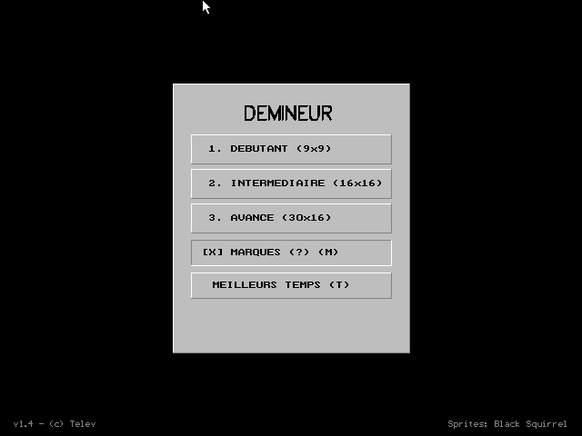
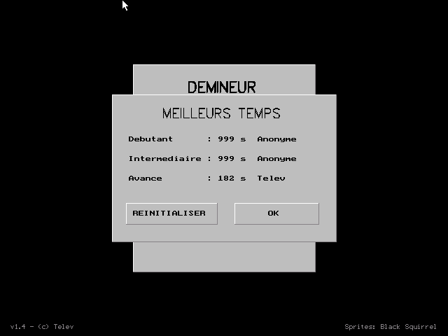
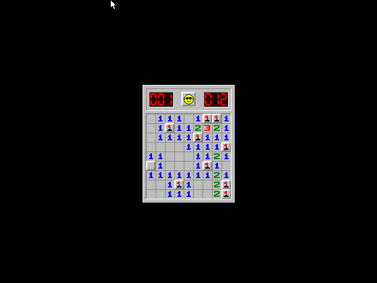
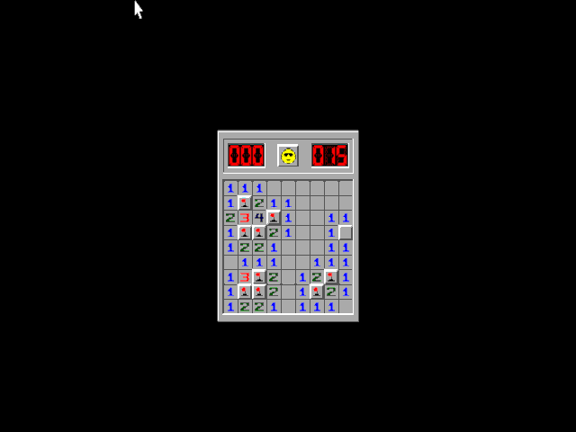
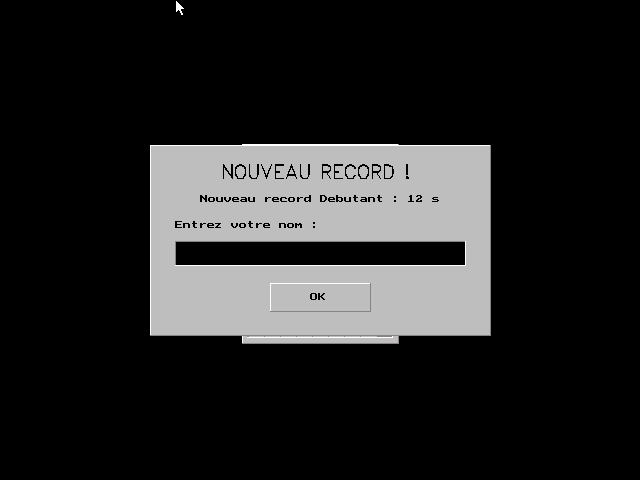
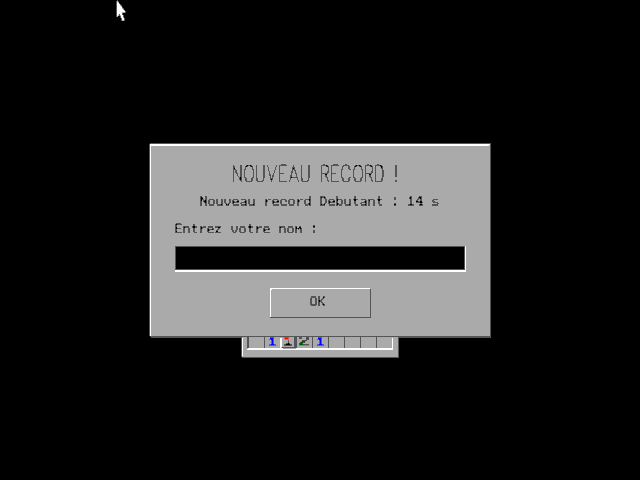
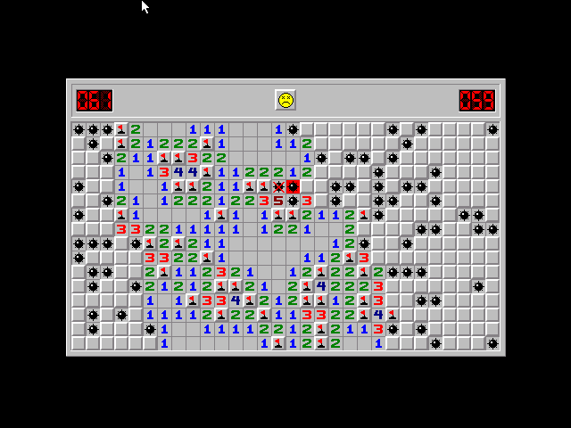

# Démineur DOS Edition

Clone rétro du **Démineur** (*Minesweeper*) pour **MS-DOS**, écrit en C++ pour **Borland C++ 3.1**.

Le jeu détecte automatiquement une carte **EGA** ou **VGA** au démarrage. L'exécutable est **autonome** : le pilote graphique BGI, les polices vectorielles et la sprite sheet par défaut sont incorporés dans le binaire, aucun fichier annexe n'est nécessaire pour jouer.

---

## Fonctionnalités

* **Trois niveaux classiques :** Débutant (9x9, 10 mines), Intermédiaire (16x16, 40 mines), Avancé (30x16, 99 mines).
* **Affichage EGA (640x350) et VGA (640x480)**, 16 couleurs, avec correction du rapport d'aspect en EGA.
* **Commandes complètes :** drapeaux, points d'interrogation (optionnels), chord (double clic), et annulation d'un clic en faisant glisser la souris hors de la case.
* **Premier clic toujours sûr**, révélation automatique des zones vides.
* **Chronomètre** jusqu'à 999 secondes, compteur de mines restantes, bouton émoji qui réagit aux actions.
* **Meilleurs temps** sauvegardés pour chaque niveau.
* **Thèmes personnalisables :** un fichier `asset.bmp` placé à côté du jeu remplace les sprites intégrés.

---

## Aperçu

<p align="center">
  
  
</p>

---

## Configuration requise

* **MS-DOS 3.0 ou supérieur**, ou compatible (FreeDOS, DOSBox, DOSBox Staging, DOSBox-X, 86Box...).
* **Processeur 8086/8088 ou supérieur** (testé sur un XT à 4,77 MHz).
* **Carte EGA ou VGA** disposant de 128ko de mémoire vidéo pour le mode 640x350 en 16 couleurs. Les cartes CGA, Hercules et MCGA ne sont pas supportées.
* **Un pilote de souris DOS** compatible INT 33h. Sans lui, le jeu affiche un message d'erreur et s'arrête.

Sous émulateur, réglez au minimum `machine=ega`, ou idéalement `machine=svga_s3` (VGA) pour DOSBox.

---

## Jouer

### Commandes en partie

| Action | Commande |
|---|---|
| Révéler une case | Clic gauche (validé au relâchement) |
| Marquer une case | Clic droit : drapeau, puis `?` si l'option est active, puis case vide |
| Chord (révéler les voisines) | Clic gauche + clic droit sur un chiffre dont le nombre de drapeaux voisins est égal au chiffre |
| Annuler un clic | Faire glisser la souris hors de la case avant de relâcher |
| Recommencer | Clic sur l'émoji (en cours de partie ou après la fin) |
| Retour au menu | `Échap` en partie, ou n'importe quelle touche après la fin |

Le compteur de gauche affiche les mines restantes (il peut descendre en négatif si vous posez trop de drapeaux). Le chronomètre démarre au premier clic.

### Menu principal

| Touche | Action |
|---|---|
| `1`, `2`, `3` | Lancer Débutant, Intermédiaire ou Avancé |
| `T` (ou `S`) | Afficher les meilleurs temps |
| `M` (ou `?`) | Activer ou désactiver les points d'interrogation |
| `Échap` | Quitter |

Tout est aussi accessible à la souris.

### Meilleurs temps

Un seul record est conservé par niveau. Quand vous battez un record, le jeu vous demande votre nom (15 caractères maximum, `Entrée` pour valider ; sans nom, le record est enregistré sous « Anonyme »).

Les scores sont enregistrés dans **`SCORES.DAT`, dans le même dossier que l'exécutable**. Si ce fichier ne peut pas être écrit (lecture seule, support protégé), l'écran des meilleurs temps affiche « Sauvegarde impossible ! » et les records ne sont conservés que pour la session en cours. Dans l'écran des scores, `R` réinitialise les temps, `Échap`, `Entrée` ou `O` ferment la fenêtre.

---

## Compilation

### Prérequis

1. Copiez le dossier d'installation de **Borland C++ 3.1** (`BORLANDC`) à la racine du projet :
   ```text
   DosMines/
   ├── BORLANDC/
   │   ├── BIN/
   │   ├── INCLUDE/
   │   ├── LIB/
   │   └── BGI/
   ├── PROJECT/
   ├── src/
   └── ...
   ```
2. Le makefile référence `C:\BORLANDC` et des chemins relatifs (`..\src`, `..\build`) : le dossier racine du projet doit donc être monté comme lecteur `C:` dans DOSBox, et la compilation se lance depuis le dossier `PROJECT\`.

### Avec Visual Studio Code

Le projet fournit des tâches VS Code qui lancent DOSBox avec la bonne configuration. Adaptez d'abord les chemins dans votre fichier `.vscode/settings.json` local :

```json
{
    "dosbox.windows.installPath": "C:\\Chemin\\Vers\\Votre\\Dossier\\DOSBox",
    "dosbox.windows.executableName": "dosbox.exe",
    "dosbox.windows.configPath": "${config:dosbox.windows.installPath}\\vscode.conf",
    "dosbox.linux.binaryName": "dosbox",
    "dosbox.linux.configPath": "${userHome}/.config/dosbox/vscode.conf"
}
```

* `Ctrl+Shift+B` (ou *Terminal > Run Build Task*) lance la tâche de build par défaut.
* Les autres tâches (exécution, nettoyage du dossier de build...) sont dans la palette de commandes : `Ctrl+Shift+P`, puis `Tâches : exécuter la tâche` (ou `Tasks: Run Task`).

L'exécutable est produit dans `build\dosmines.exe`.

### Avec l'IDE Borland C++

Un fichier de projet est disponible dans `PROJECT/` :

1. Lancez `BC.EXE` dans DOSBox ou sur une machine DOS, puis ouvrez le projet de `PROJECT/`.
2. **Important :** l'IDE a besoin des fichiers objets du pilote graphique et des polices. Si vous n'avez jamais compilé via VS Code, générez-les d'abord avec `BGIOBJ.EXE`, depuis le dossier racine du projet :
   ```cmd
   mkdir build
   .\BORLANDC\BGI\bgiobj .\BORLANDC\BGI\EGAVGA.BGI .\build\egavga.obj _EGAVGA_driver
   .\BORLANDC\BGI\bgiobj .\BORLANDC\BGI\SANS.CHR .\build\sans.obj _sansserif_font
   .\BORLANDC\BGI\bgiobj .\BORLANDC\BGI\LITT.CHR .\build\litt.obj _small_font
   ```
   Sans cette étape, l'édition de liens échouera.
3. Lancez la compilation (*Compile > Build all*).

### Avec le makefile

Depuis `PROJECT\`, la commande `make` produit la version Release (modèle large, optimisation vitesse). La commande `make -DDEBUG` produit une version de débogage avec contrôle du dépassement de pile (`-N`). `make clean` supprime les objets et l'exécutable. Les dépendances sur les fichiers d'en-tête sont gérées automatiquement.

---

## Personnaliser les sprites (`asset.bmp`)

Si un fichier `asset.bmp` est présent dans le répertoire courant au lancement du jeu, il est utilisé à la place de la sprite sheet intégrée. S'il est absent ou invalide, le jeu bascule sur la version intégrée.

### Format attendu

* BMP **4 bits** (16 couleurs maximum), **non compressé**, orientation standard (lignes de bas en haut).
* Taille d'au moins **169 x 84 pixels**.
* Les sprites sont séparés par 1 pixel et placés à ces positions (coin haut-gauche de chaque sprite) :

| Ligne (Y) | Contenu | Taille | Pas horizontal |
|---|---|---|---|
| 1 | 12 chiffres de compteur : 1 à 9, 0, tiret, vide | 13x23 | 14 px (départ X=1) |
| 25 | 5 émojis : normal, enfoncé, surpris, victoire, défaite | 24x24 | 25 px (départ X=1) |
| 50 | 8 cases : non révélée, vide, drapeau, `?`, `?` enfoncé, mine, mine explosée, fausse mine | 16x16 | 17 px (départ X=1) |
| 67 | 8 chiffres de proximité : 1 à 8 | 16x16 | 17 px (départ X=1) |

### Couleurs de l'interface

* Les biseaux et le fond des panneaux sont lus **directement dans le sprite de la case non révélée** : pixel (1, 50) pour la lumière, pixel (16, 65) pour l'ombre, pixel (8, 58) pour la surface.
* Le fond des compteurs est la couleur la plus sombre de la palette.
* Le pointeur de souris DOS utilise l'index `15` : placez-y le **blanc**, et la couleur la plus sombre à l'index `0`. L'outil `tools/remap_palette.py` s'en charge sans modifier l'image.

### Régénérer la sprite sheet intégrée

Pour changer l'asset embarqué dans l'exécutable, remplacez le BMP source, lancez `tools/bin2c.py` (il régénère `src/assetdef.cpp` et `src/assetdef.h`), puis recompilez.

---

## Outils (`tools/`)

Trois scripts Python aident à gérer les ressources graphiques :

* **`bin2c.py`** : convertit `asset.bmp` en tableau d'octets C++ qualifié `far` (`src/assetdef.cpp` et `src/assetdef.h`) pour l'intégrer à l'exécutable.
* **`palette.py`** : inspecte un BMP indexé 4 ou 8 bits et en exporte la palette sous forme d'image PNG (pavés de couleurs avec index et code hexadécimal).
* **`remap_palette.py`** : réordonne la palette d'un BMP indexé sans toucher aux pixels, pour placer la couleur la plus sombre à l'index `0` et le blanc pur à l'index `15`.

---

## Notes techniques

### Rendu EGA et correction d'aspect

En EGA (640x350), les pixels ne sont pas carrés : sur un moniteur 4:3, ils sont étirés verticalement. Pour que les sprites gardent des proportions carrées, le moteur réduit leur hauteur au chargement, en RAM, par échantillonnage au plus proche voisin :

* cases et chiffres de proximité : 16 → 12 lignes ;
* émojis : 24 → 18 lignes ;
* chiffres de compteur : 23 → 17 lignes.

Le facteur théorique est 350/480, soit environ 73 %, arrondi à 75 % (74 % pour les chiffres de compteur). Cette réduction ne coûte rien pendant la partie, mais certains traits horizontaux d'un pixel peuvent disparaître. L'interface (menus, boutons, polices, boîtes de dialogue) est recalculée et recentrée selon la hauteur détectée.

### Palette

* **VGA :** les couleurs 24 bits du BMP sont écrites directement dans les registres du DAC. L'affichage est coupé pendant le chargement pour éviter tout scintillement.
* **EGA :** chaque canal est ramené à 2 bits (64 couleurs possibles) et la palette est reprogrammée par `setpalette`.

### Moteur de jeu

* Placement des mines au premier clic, qui garantit une case sûre.
* Cascade de révélation **itérative** (aucune récursion), avec pile explicite.
* Liste des cases modifiées (*dirty list*) : seules les cases changées sont redessinées.
* Actions validées au **relâchement** du bouton. Pendant l'appui, la case visée et ses voisines (chord) s'enfoncent visuellement et se relèvent si la souris sort.
* Détection des cases adaptée à la hauteur des cellules (16 px en VGA, 12 px en EGA).
* Les boucles d'attente rendent la main au système (INT 2Fh, `AX=1680h`, puis `HLT`) pour ne pas occuper le processeur de l'hôte.
* La pile est portée à 16 Ko, et le chargement du BMP est validé (format, dimensions, taille) avant tout accès.

---

## Comparaison VGA et EGA

Les captures ci-dessous restituent l'affichage sur un moniteur 4:3.

#### Victoire

> Les cases conservent un aspect carré dans les deux modes. L'en-tête s'ajuste à la hauteur des sprites (16 px en VGA, 12 px en EGA).

<p align="center">
  
  
</p>

#### Nouveau record

> Les boîtes de dialogue s'adaptent en hauteur pour compenser la déformation du mode EGA.

<p align="center">
  
  
</p>

#### Défaite (VGA)

> Révélation des mines et des faux drapeaux, émoji de défaite.

<p align="center">
  
</p>

---

## Crédits et licence

* **Développement :** Telev, avec l'aide d'un agent IA.
* **Sprites :** un grand merci à **Black Squirrel** pour la sprite sheet originale du Démineur.
* **Licence :** le code source est publié sous [The Unlicense](LICENSE) (domaine public) : utilisez-le comme vous voulez. Les sprites restent la création de Black Squirrel et ne sont pas couverts par cette licence.
